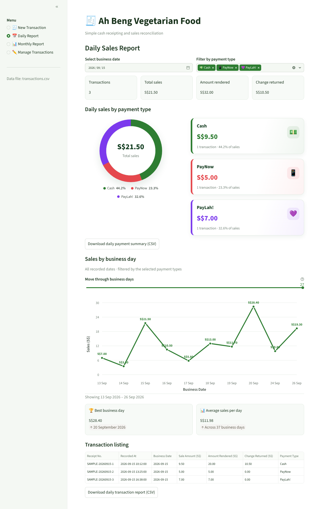
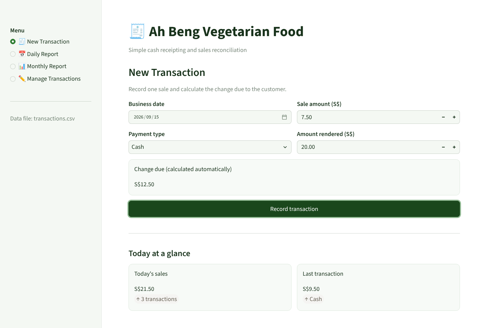
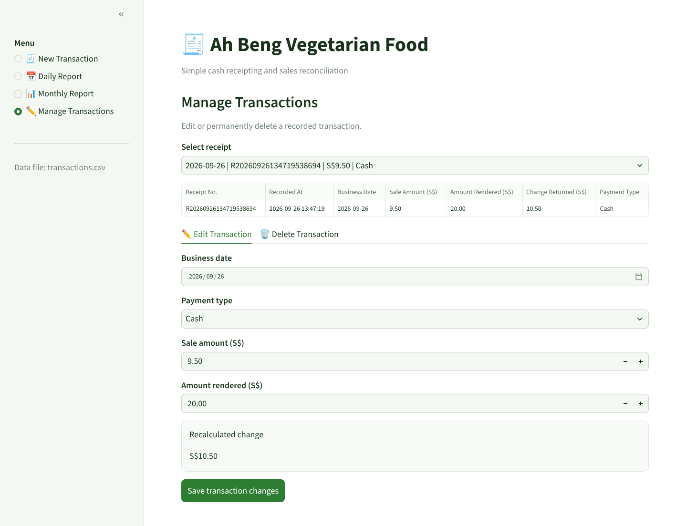
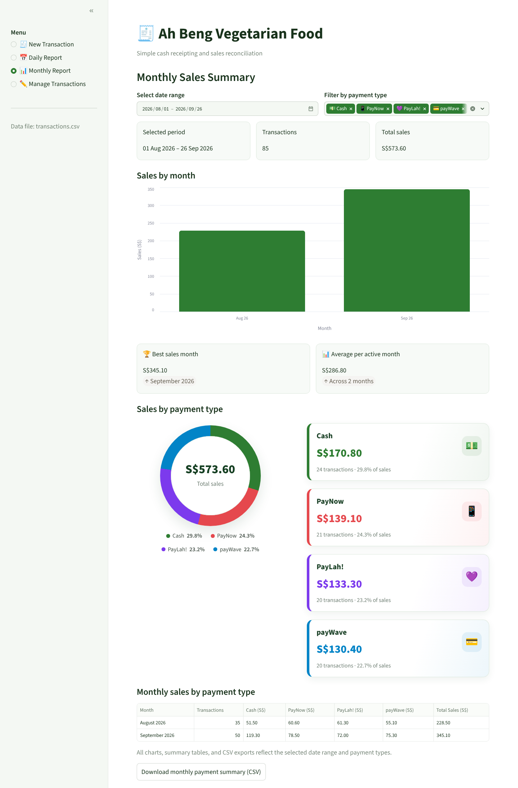

<div align="center">

# 🧾 Ah Beng Cash Receipting System

**A lightweight point-of-sale and sales-reconciliation app for Singapore hawker stalls**

[](https://github.com/chagou313/cash-receipting-system-for-Singapore-hawker-stalls/actions/workflows/tests.yml)


English | [简体中文](README.zh-CN.md)



</div>

## Overview

Many hawker stall owners still track sales with a notebook and a calculator. At the end of the day they need to answer simple questions: *How much did I sell? How much should be in the cash box? How much came in through PayNow, PayLah! or card?*

This app answers those questions. The stall owner records each sale in a few seconds and the system works out the change for cash payments. It then produces daily and monthly reports broken down by payment method. It runs locally in a browser, needs no database or internet connection, and stores everything in one CSV file that opens in Excel.

The app was built for a vegetarian food stall ("Ah Beng Vegetarian Food") as the final project for the **AN6100 Programming Essentials** course (2026).

## Features

| | Feature | What it does |
| --- | --- | --- |
| 🧾 | **Fast sale entry** | Record a sale with date, amount and payment type. Change is calculated live and short payments are flagged before saving. |
| 💳 | **Singapore payment methods** | Cash, PayNow, PayLah! and payWave, each with its own colour and icon across the app. |
| 📅 | **Daily reconciliation** | Totals for sales, cash received and change returned, so the owner can check the cash box at closing time. |
| 🍩 | **Payment breakdown** | Donut chart and cards showing each payment method's share of sales. |
| 📈 | **Sales trend** | Line chart of daily sales with a slider to scroll through history, plus best day and daily average. |
| 📊 | **Monthly summary** | Any date range: sales by month, monthly split by payment type, and a day-by-day table. |
| ✏️ | **Corrections** | Edit or delete a wrong receipt. Change is recalculated and deletion needs a confirmation. |
| ⬇️ | **CSV export** | Every summary table can be downloaded for bookkeeping or an accountant. |

## Screenshots

<table>
  <tr>
    <td width="50%"><b>New transaction</b><br></td>
    <td width="50%"><b>Manage transactions</b><br></td>
  </tr>
  <tr>
    <td colspan="2"><b>Monthly report</b><br></td>
  </tr>
</table>

## Design highlights

- **Business logic separated from the UI.** All calculations (change, totals, filters, monthly and payment summaries) are plain Python functions with no Streamlit calls. This keeps them easy to test and reuse; the Streamlit layer only reads input and renders results.
- **Money handled carefully.** Amounts are validated, rounded to two decimal places, and stored as fixed-format strings, which avoids floating-point surprises such as `10.00 - 8.80 = 1.1999…`.
- **Data integrity checks.** On load, the CSV header and every row (payment type, timestamps, dates, amounts) are validated. A bad row produces a clear error with its line number instead of a silently wrong report.
- **Safe editing.** Edits keep the original receipt number and timestamp, and the change is recalculated through the same rules as a new sale.
- **No-dependency charts.** The payment donut and the daily trend line are drawn with CSS `conic-gradient` and inline SVG. The monthly bar chart uses a Vega-Lite spec.
- **Tested.** 30 `pytest` unit tests cover the payment rules, CSV storage, edit and delete, and report calculations. They run on every push through GitHub Actions.

## Getting started

Requirements: Python 3.10+ and Streamlit 1.50+.

```bash
git clone https://github.com/chagou313/cash-receipting-system-for-Singapore-hawker-stalls.git
cd cash-receipting-system-for-Singapore-hawker-stalls
python3 -m pip install -r requirements.txt
python3 -m streamlit run app.py
```

The app opens at http://localhost:8501. Press `Ctrl + C` in the terminal to stop it.

Run the command from the project folder so Streamlit picks up the green theme in `.streamlit/config.toml`.

### Run the tests

```bash
python3 -m pip install pytest
python3 -m pytest -v
```

## Project structure

```
cash-receipting-system-for-Singapore-hawker-stalls/
├── app.py                      # Business logic + Streamlit interface
├── data/
│   └── transactions.csv        # Sales records (ships with sample data)
├── tests/
│   └── test_app.py             # Unit tests for the business logic
├── docs/screenshots/           # Images used in this README
├── .streamlit/config.toml      # Theme and server settings
├── .github/workflows/tests.yml # CI: runs the tests on every push
└── requirements.txt
```

## Data format

Each sale is one row in `data/transactions.csv`:

| Column | Example | Meaning |
| --- | --- | --- |
| `transaction_id` | `R20260926134255115885` | Receipt number, generated from the time of sale |
| `timestamp` | `2026-09-26 13:42:55` | When the sale was recorded |
| `business_date` | `2026-09-26` | The trading day the sale belongs to |
| `sale_amount` | `9.80` | Sale amount (S$) |
| `amount_rendered` | `10.00` | Amount the customer paid (equals the sale for electronic payments) |
| `change_amount` | `0.20` | Change returned (`0.00` for electronic payments) |
| `payment_type` | `Cash` | `Cash`, `PayNow`, `PayLah!` or `payWave` |

The file ships with sample sales from August–September 2026. Delete it to start fresh; a new one is created with the first sale. Don't rename the columns, and stop the app before opening the file in another program.

## Possible next steps

- Menu items and quantities instead of a single sale amount
- SQLite storage for multiple devices or larger volumes
- Printable or shareable digital receipts
- Deployment to Streamlit Community Cloud with a login for the stall owner

## License

[MIT](LICENSE) © 2026 Xu Jie
