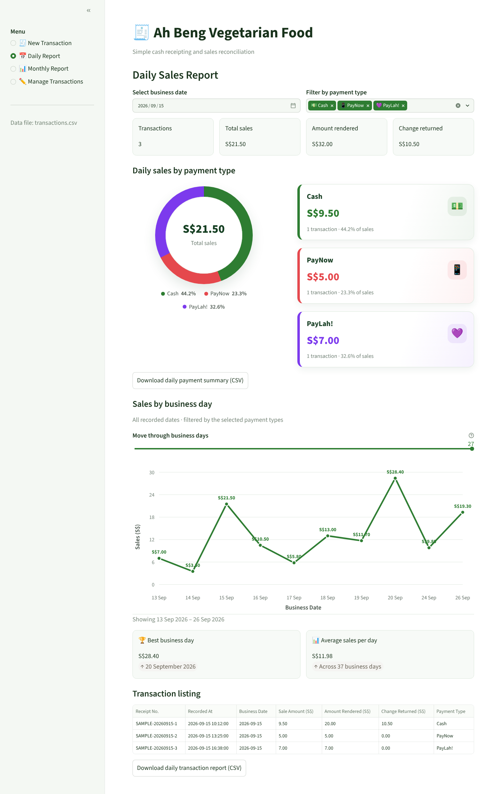
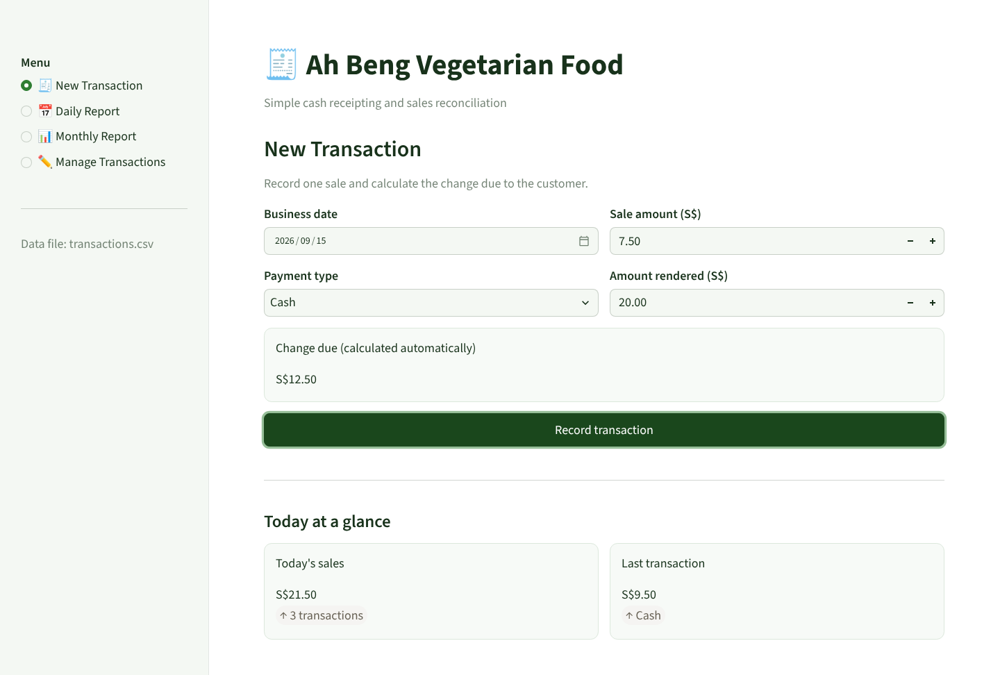
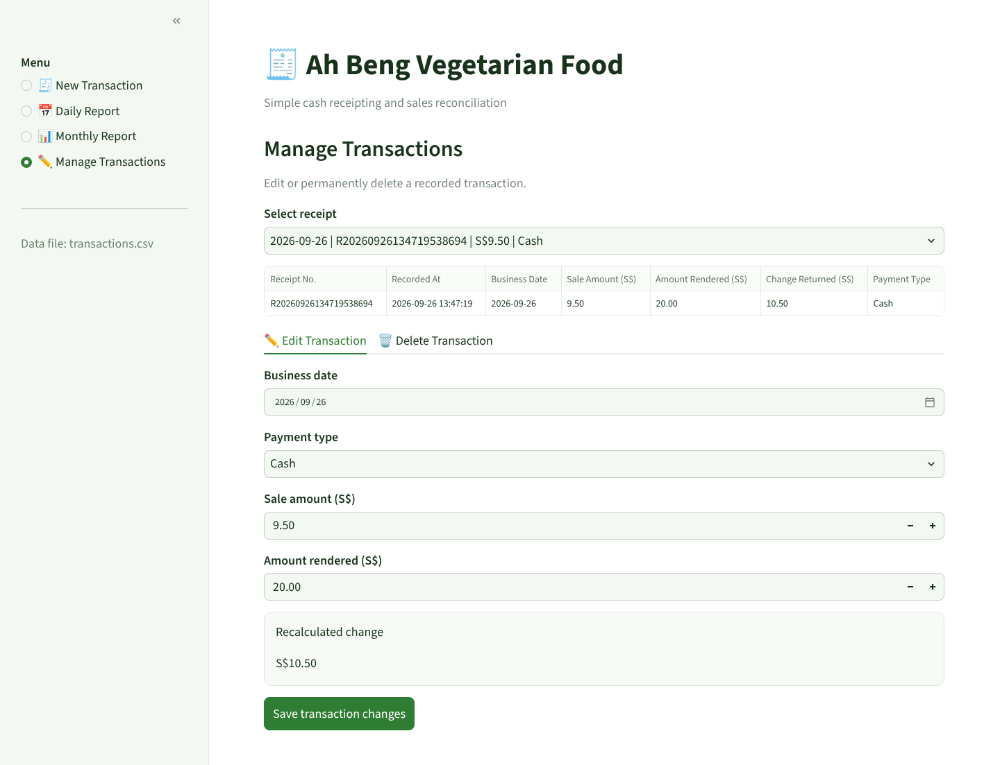
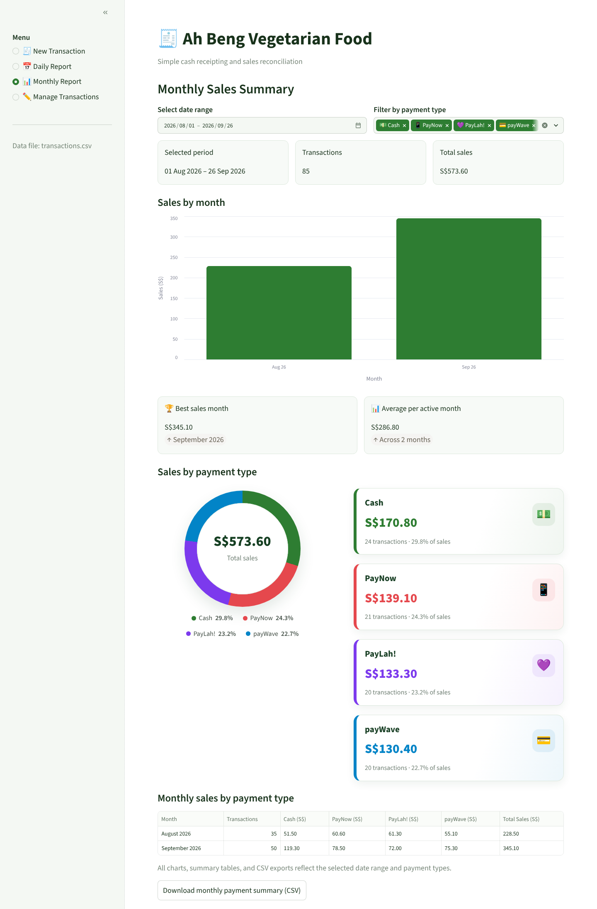

<div align="center">

# 🧾 Ah Beng 收银系统

**为新加坡小贩中心摊主设计的轻量收银与对账应用**

[](https://github.com/chagou313/ah-beng-receipting/actions/workflows/tests.yml)


[English](README.md) | 简体中文



</div>

## 项目简介

很多小贩中心的摊主还在用本子和计算器记账。每天收摊时，他们需要知道：*今天卖了多少？钱箱里应该有多少现金？PayNow、PayLah! 和刷卡各收了多少？*

这个应用就是用来回答这些问题的。摊主几秒钟就能记一笔销售，现金付款的找零由系统自动计算，并生成按付款方式细分的每日和每月报表。应用在本地浏览器运行，不需要数据库，也不需要联网，所有数据保存在一个 CSV 文件里，可以直接用 Excel 打开。

本项目以一家素食摊（"Ah Beng Vegetarian Food"）为原型，是 **AN6100 Programming Essentials** 课程（2026）的期末项目。

## 功能

| | 功能 | 说明 |
| --- | --- | --- |
| 🧾 | **快速记账** | 输入日期、金额和付款方式即可记录。找零实时计算，付款不足时在保存前提示。 |
| 💳 | **新加坡常用付款方式** | 支持 Cash、PayNow、PayLah!、payWave，每种方式在整个应用中都有统一的颜色和图标。 |
| 📅 | **每日对账** | 汇总当天销售额、收到的现金和找零金额，方便收摊时核对钱箱。 |
| 🍩 | **付款方式占比** | 环形图和卡片显示各付款方式的销售占比。 |
| 📈 | **销售趋势** | 每日销售折线图，可拖动滑块查看历史数据，并显示最佳营业日和日均销售额。 |
| 📊 | **月度汇总** | 可选任意日期范围：按月销售额、按月和付款方式的交叉表、逐日明细。 |
| ✏️ | **修改记录** | 可编辑或删除错误的收据，找零会重新计算，删除前需要确认。 |
| ⬇️ | **导出 CSV** | 所有汇总表都能下载，方便记账或交给会计。 |

## 截图

<table>
  <tr>
    <td width="50%"><b>新增交易</b><br></td>
    <td width="50%"><b>管理交易</b><br></td>
  </tr>
  <tr>
    <td colspan="2"><b>月度报表</b><br></td>
  </tr>
</table>

## 设计亮点

- **业务逻辑与界面分离**：找零、汇总、筛选、月度和付款方式统计等计算都写成不依赖 Streamlit 的普通 Python 函数，便于测试和复用；界面层只负责读取输入和展示结果。
- **严谨处理金额**：所有金额都会校验并保留两位小数，再以固定格式存储，避免 `10.00 - 8.80 = 1.1999…` 这类浮点误差。
- **数据完整性检查**：读取 CSV 时会校验表头和每一行的付款方式、时间、日期和金额；数据有误时报出具体行号，而不是悄悄生成错误的报表。
- **安全修改**：编辑时保留原收据号和记录时间，找零按与新交易相同的规则重新计算。
- **无额外依赖的图表**：付款占比环形图用 CSS `conic-gradient` 绘制，每日趋势折线图用内联 SVG 绘制，月度柱状图使用 Vega-Lite。
- **自动化测试**：30 个 `pytest` 单元测试覆盖付款规则、CSV 存储、编辑删除和报表计算，每次推送都会通过 GitHub Actions 自动运行。

## 快速开始

环境要求：Python 3.10 及以上，Streamlit 1.50 及以上。

```bash
git clone https://github.com/chagou313/ah-beng-receipting.git
cd ah-beng-receipting
python3 -m pip install -r requirements.txt
python3 -m streamlit run app.py
```

浏览器会打开 http://localhost:8501。在终端按 `Ctrl + C` 即可停止。

请在项目文件夹内运行命令，这样 Streamlit 才会读取 `.streamlit/config.toml` 里的绿色主题。

### 运行测试

```bash
python3 -m pip install pytest
python3 -m pytest -v
```

## 项目结构

```
ah-beng-receipting/
├── app.py                      # 业务逻辑 + Streamlit 界面
├── data/
│   └── transactions.csv        # 销售记录（附示例数据）
├── tests/
│   └── test_app.py             # 业务逻辑的单元测试
├── docs/screenshots/           # README 中使用的截图
├── .streamlit/config.toml      # 主题和服务器设置
├── .github/workflows/tests.yml # CI：每次推送自动运行测试
└── requirements.txt
```

## 数据格式

每笔销售是 `data/transactions.csv` 中的一行：

| 列名 | 示例 | 含义 |
| --- | --- | --- |
| `transaction_id` | `R20260926134255115885` | 收据号，根据销售时间生成 |
| `timestamp` | `2026-09-26 13:42:55` | 记录时间 |
| `business_date` | `2026-09-26` | 销售所属的营业日 |
| `sale_amount` | `9.80` | 销售金额（新元） |
| `amount_rendered` | `10.00` | 顾客支付的金额（电子支付时等于销售金额） |
| `change_amount` | `0.20` | 找零（电子支付为 `0.00`） |
| `payment_type` | `Cash` | `Cash`、`PayNow`、`PayLah!` 或 `payWave` |

文件自带 2026 年 8–9 月的示例数据。删除该文件即可从零开始，记录第一笔销售时会自动新建。请不要修改列名；用其他程序打开文件前，请先停止应用。

## 后续可改进方向

- 支持菜品和数量，而不只是一个销售总额
- 改用 SQLite 存储，支持多设备或更大数据量
- 可打印或分享的电子收据
- 部署到 Streamlit Community Cloud，并为摊主加上登录

## 许可证

[MIT](LICENSE) © 2026 Xu Jie
